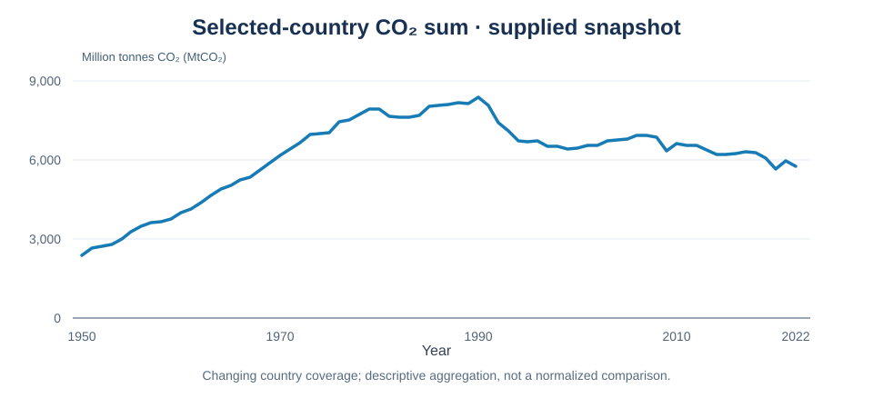
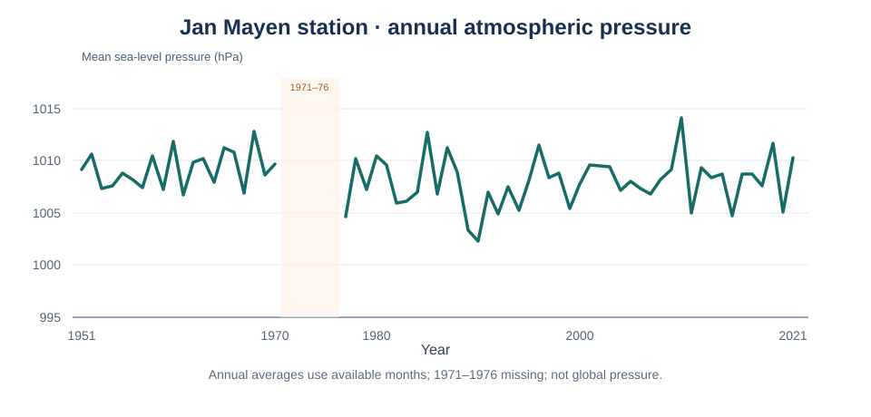

# CO₂ Emissions & Atmospheric Pressure Analytics

**A reproducible Python + SQLite data engineering portfolio project**

**Python · ETL · SQL / SQLite · Data Validation · Time Series · Data Provenance · GitHub Actions**

This repository demonstrates how I build a small, inspectable **end-to-end data pipeline**: ingesting independently sourced environmental datasets, checking their schemas and key constraints, normalizing time-series measurements, writing to SQLite, and producing data-quality summaries and separate descriptive charts.

It is a **standalone portfolio reimplementation** inspired by my Methods of Advanced Data Engineering (MADE) coursework at Friedrich-Alexander-Universität Erlangen–Nürnberg (FAU). The [original course fork](https://github.com/MD-IKRAM169/MADE-23158587) is unchanged and remains available for academic provenance. This is not an official university project release.

> **Scientific scope:** DWD station **01001 / Jan Mayen** provides *mean sea-level-reduced atmospheric pressure in hPa* at **one weather station**, not a global pressure mean or a measurement of ocean height. Multi-country CO₂ emissions and single-station pressure differ in geographic scope. These analyses are **descriptive** and do **not** establish causal relationships.

## What I built

| Engineering area | Demonstrated deliverable |
|---|---|
| **Extract** | Local OWID comma-delimited CSV and DWD CLIMAT semicolon-delimited TXT |
| **Validate** | Required columns, numeric years, duplicate keys, missing values, implausible station pressures |
| **Transform** | Project-specific country selection and 12-month-to-long-format station observations |
| **Load** | Three SQLite tables with primary keys and a source-provenance table |
| **Audit** | JSON report of missing years/months, CO₂ coverage and mixed geographic granularity |
| **Test** | Offline unit tests plus an automated GitHub Actions CLI smoke test |
| **Communicate** | Charts, explicit measurement units, reproducibility instructions and limitations |

### Pipeline architecture

~~~mermaid
flowchart LR
    A[OWID country-year CO₂ CSV] --> C[Validate and filter]
    B[DWD 01001 monthly CLIMAT TXT] --> D[Validate and unpivot months]
    C --> E[(SQLite: co2_country_year)]
    D --> F[(SQLite: jan_mayen_monthly_pressure)]
    E --> G[Coverage &amp; missing-data audit]
    F --> G
    G --> H[JSON report and optional plots]
~~~

## Historical data snapshot

The following figures describe the **historical source snapshots associated with the original student project**, not a live/current data fetch or the small demo fixtures.

| Observation | Value in supplied snapshot |
|---|---:|
| Selected country/territorial labels | **50** |
| Country-year records | **9,171** |
| Records with nonmissing CO₂ | **7,373** |
| Year span in CO₂ extract | **1750–2022** (course analysis emphasized 1850–2022) |
| Jan Mayen station years present | **65** in 1951–2021 |
| Whole station years absent | **1971–1976** |
| Valid monthly station readings | **766 / 780** |

Country coverage changes by year, and the 50 labels include transcontinental states. It is **not** a harmonized EU-only series.

### Descriptive visualizations

*Annual sum of available CO₂ observations for the selected countries, in MtCO₂. Coverage changes across years.*

*Annual mean of available monthly mean sea-level-reduced air pressure readings in hPa at Jan Mayen; the 1971–1976 gap is not interpolated.*

See [methodology & limitations](docs/METHODOLOGY_AND_LIMITATIONS.md) before interpreting the curves.

## Run the project in under five commands

**Requirements:** Python 3.10+; **no third-party dependencies** for the pipeline, SQLite output or unit tests.

~~~bash
git clone https://github.com/MD-IKRAM169/CO2-Emissions-Atmospheric-Pressure-Analytics.git
cd CO2-Emissions-Atmospheric-Pressure-Analytics

python -m unittest discover -s tests -v

python -m portfolio.pipeline \
  --co2 examples/synthetic_co2.csv \
  --pressure examples/synthetic_pressure.csv \
  --database outputs/demo.sqlite \
  --summary outputs/demo_summary.json
~~~

The example inputs are **fictional test fixtures**, not real environmental records. The command creates \`outputs/demo.sqlite\` and \`outputs/demo_summary.json\`. The program intentionally refuses to overwrite existing output files; choose new names or explicitly remove old outputs to rerun.

### Work with authorized historical datasets

Download your own source versions from [OWID](https://github.com/owid/co2-data) and [DWD CLIMAT](https://opendata.dwd.de/climate_environment/CDC/observations_global/CLIMAT/monthly/qc/mean_sea_level_pressure/historical/). The course project's historical local filenames were \`europe_co2_data.csv\` and \`global sea level.csv\` (the latter is **air pressure**, not ocean height).

~~~bash
python -m portfolio.pipeline \
  --co2 path/to/europe_co2_data.csv \
  --pressure "path/to/global sea level.csv" \
  --database outputs/historical.sqlite \
  --summary outputs/historical_audit.json
~~~

Optional plotting of your own run:

~~~bash
python -m pip install matplotlib
python -m portfolio.visualize --database outputs/historical.sqlite --out outputs/charts
~~~

See the [reproducibility guide](docs/REPRODUCIBILITY.md) for SQL queries and the [data sources page](docs/DATA_SOURCES.md) for formats and licensing caveats.

## Repository map

~~~text
portfolio/
  pipeline.py                    # Extract, validate, transform, load, audit
  visualize.py                   # Optional Matplotlib charts from SQLite
tests/
  test_pipeline.py               # Offline synthetic-data unit tests
examples/
  synthetic_co2.csv              # Fictional demo data
  synthetic_pressure.csv         # Fictional demo data
docs/
  DATA_SOURCES.md                # Provenance, source files and units
  METHODOLOGY_AND_LIMITATIONS.md # Data decisions and scientific caveats
  REPRODUCIBILITY.md             # CLI usage, schema and SQL examples
  RECRUITER_OVERVIEW.md          # Technical interview summary
  PROVENANCE_AND_PUBLICATION.md  # Academic attribution and publishing boundaries
  figures/                       # Charts from a supplied historical snapshot
.github/workflows/tests.yml      # Test and demo pipeline automation
~~~

## Design decisions worth discussing in interviews

The project deliberately treats missing values as null rather than silently filling gaps, stores monthly observations in normalized form rather than 12 separate columns, and uses composite keys to detect duplicate observations. It separates data engineering from scientific claims and makes the pipeline testable without fetching large datasets.

For an interview-friendly summary, see [Recruiter overview](docs/RECRUITER_OVERVIEW.md).

## Responsible publication and attribution

The original FAU coursework repository and university grading files are **not** modified. This standalone project does not include the source PDFs, presentation credentials, or original third-party historical datasets pending a rights review. Source snapshots used to create the descriptive vector charts may not match today's upstream versions. No independently validated causal or forecasting claims are made.

**Data attribution:** [Our World in Data](https://github.com/owid/co2-data) and [Deutscher Wetterdienst](https://opendata.dwd.de/climate_environment/CDC/observations_global/CLIMAT/monthly/qc/mean_sea_level_pressure/historical/).

**Code license:** No standalone code license has been chosen yet. The university template was MIT-licensed, but licenses for this new code and third-party data need separate review.
